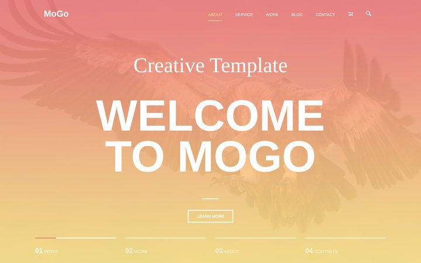

# My Works

Responsive landing pages built from Figma/PSD designs while studying frontend development (2022–2023).

**Live gallery:** https://chaika911.github.io/My-Works/

## Projects

| Project | Stack | Demo |
|---|---|---|
| MoGo | HTML, CSS | [open](https://chaika911.github.io/My-Works/MoGo/index-mogo.html) |
| Jabson | HTML, SCSS, JavaScript | [open](https://chaika911.github.io/My-Works/Jabson/) |
| LuxChaffeur | HTML, SCSS | [open](https://chaika911.github.io/My-Works/LuxChaffeur/) |
| Circlechain | HTML, SCSS, JavaScript | [open](https://chaika911.github.io/My-Works/Circlechain/) |
| Photo Studio | HTML, CSS | [open](https://chaika911.github.io/My-Works/Photo%20Studio/Index.html) |
| Tour and Travel | HTML, SCSS, JavaScript | [open](https://chaika911.github.io/My-Works/tour%20and%20travel/) |
| Travel Agency | HTML, SCSS, JavaScript | [open](https://chaika911.github.io/My-Works/TravelAgency/) |
| Bouncy | HTML, CSS Grid | [open](https://chaika911.github.io/My-Works/grid_layout/) |
| ActiveBox | HTML, CSS | [open](https://chaika911.github.io/My-Works/ActiveBox/) |

## Author

Vitalii Chaika — [portfolio](https://chaika911.github.io/myCV/) · [LinkedIn](https://www.linkedin.com/in/vitalii-chaika-dev/)
